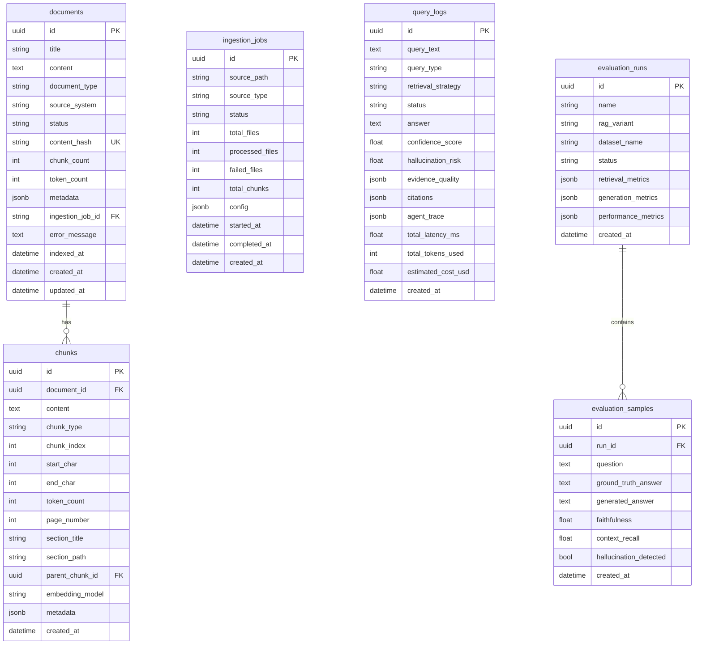

# Phase 1 — Architecture

## System Architecture Diagram

```
┌─────────────────────────────────────────────────────────────────────────────┐
│                     EnterpriseIT-RAG Platform (Phase 1)                     │
├───────────────────────────────────────────────────────────────────────────────┤
│                                                                               │
│  Client (curl / Postman / Future Next.js)                                    │
│          │                                                                    │
│          ▼ HTTP/HTTPS                                                         │
│  ┌──────────────────────────────────────────────────────────────┐            │
│  │                    FastAPI Application                        │            │
│  │                                                               │            │
│  │  Middleware Stack:                                            │            │
│  │  ┌────────────────┐ ┌──────────────────┐ ┌───────────────┐  │            │
│  │  │ RequestLogging │ │ CORS Middleware   │ │ ExceptionMap  │  │            │
│  │  └────────────────┘ └──────────────────┘ └───────────────┘  │            │
│  │                                                               │            │
│  │  API Routes (v1):                                            │            │
│  │  ┌─────────────┐ ┌──────────────────┐ ┌─────────────────┐  │            │
│  │  │ /health     │ │ /documents       │ │ /search (stub)  │  │            │
│  │  │ /ready      │ │ GET/POST/DELETE  │ │                 │  │            │
│  │  │ /version    │ │ /upload          │ │                 │  │            │
│  │  └─────────────┘ └──────────────────┘ └─────────────────┘  │            │
│  │                                                               │            │
│  │  Dependency Injection (FastAPI Depends):                     │            │
│  │  ┌──────────────────────────────────────────────────────┐   │            │
│  │  │  Settings | AsyncSession | Redis | Repositories      │   │            │
│  │  └──────────────────────────────────────────────────────┘   │            │
│  └──────────────────────────────────────────────────────────────┘            │
│          │                                                                    │
│          ▼                                                                    │
│  ┌──────────────────────────────────────────────────────────────┐            │
│  │                  Application Layer (Services)                 │            │
│  │  ┌──────────────────────────┐  ┌──────────────────────────┐  │            │
│  │  │    DocumentService       │  │    QueryService (Ph.3)   │  │            │
│  │  │  - create_document()     │  │    (stub)                │  │            │
│  │  │  - get_document()        │  │                          │  │            │
│  │  │  - list_documents()      │  │                          │  │            │
│  │  │  - delete_document()     │  │                          │  │            │
│  │  │  - get_statistics()      │  │                          │  │            │
│  │  └──────────────────────────┘  └──────────────────────────┘  │            │
│  └──────────────────────────────────────────────────────────────┘            │
│          │                                                                    │
│          ▼                                                                    │
│  ┌──────────────────────────────────────────────────────────────┐            │
│  │                    Domain Layer                               │            │
│  │                                                               │            │
│  │  Entities:     Document │ Chunk │ Query │ QueryResult        │            │
│  │  Value Objects: EvidenceScore (6-dimensional scoring)        │            │
│  │  Interfaces:   DocumentRepository │ ChunkRepository          │            │
│  │               VectorStore (abstract)                          │            │
│  │  Exceptions:  InsufficientEvidenceError │ HallucinationError │            │
│  └──────────────────────────────────────────────────────────────┘            │
│          │                                                                    │
│          ▼                                                                    │
│  ┌──────────────────────────────────────────────────────────────┐            │
│  │                  Infrastructure Layer                         │            │
│  │                                                               │            │
│  │  ┌─────────────────┐  ┌──────────────┐  ┌────────────────┐  │            │
│  │  │  PostgreSQL      │  │    Redis     │  │   Celery       │  │            │
│  │  │  (SQLAlchemy)    │  │  (cache)     │  │   Workers      │  │            │
│  │  │                  │  │              │  │                │  │            │
│  │  │  documents       │  │  Query cache │  │  ingestion     │  │            │
│  │  │  chunks          │  │  Doc cache   │  │  evaluation    │  │            │
│  │  │  ingestion_jobs  │  │  Emb cache   │  │  cleanup       │  │            │
│  │  │  query_logs      │  │              │  │                │  │            │
│  │  │  eval_runs       │  │              │  │                │  │            │
│  │  └─────────────────┘  └──────────────┘  └────────────────┘  │            │
│  └──────────────────────────────────────────────────────────────┘            │
└───────────────────────────────────────────────────────────────────────────────┘
```

## Clean Architecture Dependency Rule

```
API Layer → Application Layer → Domain Layer ← Infrastructure Layer
```

- Inner layers have **no dependencies** on outer layers
- Domain entities are pure Python dataclasses — no ORM, no FastAPI
- Infrastructure implements domain interfaces (Repository Pattern)
- FastAPI dependencies wire everything together via DI

## Database Schema (Phase 1)



## Key Design Decisions

1. **PostgreSQL JSONB for metadata** — Avoids schema migrations when adding new source systems. Metadata is queryable with GIN indexes.

2. **Content hash deduplication** — SHA-256 hash prevents duplicate ingestion of identical documents, critical for large enterprise deployments.

3. **Celery task isolation** — Ingestion runs async in separate worker process. API server never blocks on slow operations (PDF parsing, embedding generation).

4. **Repository pattern** — Domain code never imports SQLAlchemy. Repositories map ORM models ↔ domain entities. Enables unit testing without databases.

5. **Frozen EvidenceScore** — Immutable value object prevents accidental mutation of quality scores between agents.

6. **lru_cache settings** — Settings loaded once per process. Tests call `get_settings.cache_clear()` between cases.
